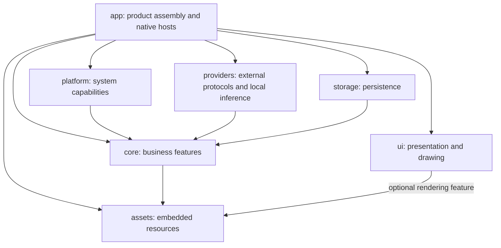

# SnapLingo architecture

For the architecture rationale, upstream comparisons and migration steps,
see [Native workspace design](docs/architecture/native-workspace-design.md).
Checks and native acceptance scope are documented in
[Architecture verification](docs/architecture/verification.md).

SnapLingo is a native Rust application organized around cohesive product features.
Seven production Cargo packages separate the desktop product from reusable business,
presentation, system, provider, persistence and asset code. A package is introduced for an
independent dependency or reuse constraint; related implementation modules stay
together inside that package.

Earlier migration records are historical evidence, not the current module map.

## Dependency direction

Arrows mean “depends on.” Target-specific dependencies count even when the current
machine does not compile them.



`core` does not depend on UI, storage, native frameworks or the application.
`ui` does not depend on Core, platform adapters, databases or window frameworks.
Platform, Providers and Storage implement contracts owned by the Core module that consumes
them. The desktop application is the composition root: it selects adapters and
supplies each native feature with its actual dependencies.

`tools/reference` is an additional development package, independent of production
packages. Retained React sources under `reference/web` supply independent visual
and behavior references. They do not participate in native startup or packaging.

## Directory map

```text
app/
  Cargo.toml                    package snaplingo; existing executable identities
  src/
    main.rs, native_main.rs     native entry points
    lib.rs                     entry and explicit application exports
    bootstrap/                 composition, application state, notifications
    shell/                     event loops, tray, actions, startup and shutdown
    features/
      settings/
        presenter/             shared sessions, ordered edits, UI projections
        host/                  winit host used by Windows and the preview
        macos/, windows/       native adapters and sheets
      capture/                 editing host, workflow projection, native adapters
      result/                  controller, presentation mapping, native adapters
      pinned/                  image preparation, placement, native adapters
      scrolling/               sampler lifetime, native controls and overlays
    integrations/              product events, runtime, updates and native helpers
    test_support/              optional linked native scenarios and isolated setup
  tests/                       real composition and native acceptance
  examples/                    application-owned previews and probes
crates/
  core/src/
    capture/                   models, selection, editor, capture/output workflow
    providers/                 OCR/translation coordination and configuration
    settings/, hotkeys/        durable preferences and shortcut workflows
    library/                   history, favorites, capacity and lightweight index
    result/, pinned/           business state and window-host contracts
    selection/                 selected-text acquisition and translation policy
    permissions.rs, speech.rs  permission and speech policy
    updates.rs                 release/update policy
  ui/src/
    foundation/                geometry, colors, text, input and semantic theme
    settings/                  Settings presentation models, state and layout
    capture/, result/, pinned/, scrolling/
    library/, services/, notices/, permission_prompt/
    render/                    optional CPU rendering
    accessibility/             optional AccessKit semantic projection
  platform/src/                screenshot, selection, system OCR/TTS, clipboard,
                               fonts, hotkeys, permissions, paths, login, dialogs
  providers/src/               external HTTP/translation/LLM/OCR protocols;
    ocr/paddle/                optional local inference with ORT/MNN
  storage/src/                 SQLite repositories and filesystem assets
  assets/src/                  production resource embedding
assets/                        fonts, defaults, UI text and generated notices
reference/web/                 retained browser views and fixtures
tools/                         independent collectors and native development tools
script/                        development, packaging and verification
```

Every production package uses Cargo's conventional `src/` directory. Core modules
place models, workflows and consumed ports together by feature. For example,
`core::capture::model` supplies capture values and `core::capture` supplies editing
and session behavior; consumers do not import a generic `domain` or `application`
module tree. `lib.rs` declares the feature interfaces rather than combining their
contents through wildcard exports.

## Module ownership

| Owner | Owns | Excludes |
| --- | --- | --- |
| Core feature | Business values, transitions, validation, ordering and local ports | Concrete OS, database, network-client or window types |
| UI feature | Presentation models, logical layout, input behavior and typed intents | Workflow construction, persistence and native window lifetime |
| UI rendering | Text shaping, glyph/shape rasterization, premultiplied RGBA | Business policy and OS event routing |
| UI accessibility | Roles, values, bounds and actions derived from shared presentation | Native AX/UIA lifetime and application service lookup |
| Platform capability | Actual OS capability implementations behind Core contracts | AppState, application event loops, product layout and storage |
| Provider adapter | External protocols, HTTP transport and optional inference sessions | Product windows, AppState and database implementations |
| Storage adapter | Database migrations/transactions and persisted image files | Provider choice, window state and UI interaction |
| Desktop feature | Shared presenter/controller, feature dependencies and adjacent native hosts | Resolving AppState or constructing dependencies through bootstrap |
| Bootstrap | Concrete adapter selection, state assembly, subscriptions and injected callbacks | Reusable interaction or business decisions |
| Shell | Resident lifecycle, event loop, tray/menu/hotkey entry routing | Durable business mutations and duplicate feature workflows |

A port lives beside its consumer, not in a global interface bucket. Settings receives home and default screenshot
paths from composition; Platform performs OS path discovery. Core construction
never consults the machine's user directories. Native hosts
receive feature `Services` values or a prepared session/factory. Only bootstrap
knows how those values come from the complete application. Required effects such
as dialogs or restarting the app cross explicit callbacks/contracts.

The Settings presenter stays with the desktop feature because it coordinates
product workflows; its UI projection and layout remain reusable in `ui`. The
former Settings, Render, Accessibility and Desktop packages are modules under
their actual owners, avoiding a package for every technical layer.

Settings owns confirmation and execution in its shared window session. A pending
confirmation retains the original page and intent; native adapters only display
the request and return a decision. Cancellation, navigation and window closure
invalidate it, and acceptance consumes it once. Both the product and standalone
preview use the same confirmation policy.

## Native behavior and reuse

Both macOS and Windows consume shared Rust presentation. AppKit can apply shared
rectangles/state to native controls; Windows can draw a shared Scene. They need
not use identical drawing mechanics to share layout and interaction policy.
macOS remains the reference for existing appearance and interaction semantics.
Capture toolbar and palette layout/state, selection labels, masks and magnifier
geometry live in `ui::capture::presentation`. AppKit controls and the Windows
scene consume that same interface. Actual AppKit control frames and state match
the retained independent fixtures after the refactor.

The UI crate enables `rendering` for its CPU rasterizer and `accessibility` for
its semantic projection. Callers that only need presentation and input can omit
both. A native host owns device DPI, IME, surrounding-text services, clipboard,
menus/dialogs, focus, accessibility adapters and window lifetime. Saved interface
zoom remains separate from device DPI. Opaque Settings frames use the host's
opaque presenter; transparent capture/pin/scrolling surfaces require an alpha
presenter.

Capture freezes monitor pixels and geometry together. OS acquisition remains in
Platform, editing/output policy in Core, and window interaction in the desktop
Capture feature. The frozen coordinate convention applies to cursor mapping,
control detection and output after refresh as well as initial capture. Scrolling
keeps one sampler and cancellation-safe restoration. Result controllers retain
request validity, stale-result rejection and native text selection/IME behavior.

Capture completion in the desktop feature owns command/mode decisions, save
preferences, OCR handoff and favorite completion ordering. Native adapters
provide dialogs, printing and window effects. Core retains frozen pixels and
output execution. Cancellation restores the existing session; failures return
to one native error/recovery update and keep failed output retryable.

Platform capabilities group real OS implementations beside each other, for
example `platform/selection/{macos,windows,linux}`. Native window helpers that
need the application's event loop stay in desktop integrations. General color
selection serves Settings and Capture through Platform directly. Providers owns
HTTP, cloud protocols and packaged local inference; its default build excludes
ORT/MNN, enabled by the product through `local-ocr`. Core retains provider
selection/configuration and pure translation/OCR strategies. Desktop integrations
retain log delivery, update installation and event-loop helpers.

`ui::foundation::Scene` contains only size and drawing commands. Feature frames
own hit regions, geometry, scrolling, IME and semantics. The renderer imports
foundation directly; independent windows receive `Appearance` and any needed
key style instead of the Settings snapshot. Retained AppKit reference pages live
under `features/settings/test_support`, compiled only for tests or the explicit
native acceptance feature.

## Extending the codebase

For a business feature, first identify the Core module that owns its decisions.
Put values and consumed ports beside that workflow. Add pure presentation to the
matching UI module, then add desktop presenter/host code only where OS effects or
native lifetime are needed. Bootstrap constructs adapters once and injects the
feature dependencies. Do not add a crate solely to mirror these directories.

For another platform, implement the existing capability contracts under Platform
and supply a desktop event loop and native feature hosts under the application.
Reuse Core workflows and UI presentation. Select the new adapters in bootstrap;
Core and UI must remain unaware of the new OS types. Portable libraries can be
used separately; a complete Linux desktop host is not implemented today.

For UI reuse, depend on `snaplingo-ui` and enable only the needed drawing/semantic
features. Supply snapshots, feed normalized input, consume intents, and render
Scenes or apply presentation rectangles to native controls. Keep Core-to-UI
conversion in the consuming application's presenter. UI must never construct
application services or decode persisted files while drawing.

## Verification

[Workspace architecture tests](crates/ui/tests/workspace_architecture.rs) inspect
Cargo edges and source ownership. [Desktop architecture tests](app/tests/architecture_dependency_test.rs)
cover Core model/workflow isolation, injected feature dependencies, explicit
adapter imports, frozen capture coordinates, provider delegation and independent
production resources. Synthetic invalid examples verify that the guards reject
the coupling they claim to prevent.

Core tests exercise portable workflows with memory adapters. Storage tests cover
actual transactions and persistence. Platform tests cover capability contracts,
including real subprocess single-instance ownership. Desktop integration tests
cover real composition and native window/input workflows. Native targets opt in
with `--features test-support` and call one linked scenario runner. Its internal
support owns isolated database/path setup and main-thread delivery. Tests do not
rewrite bootstrap source or mount a second copy of the production module graph;
normal product builds omit the runner and native probes. AppKit/React fixtures
are independent geometry and visual baselines; expected values are not generated
from the new shared implementation.

Cross compilation proves compilation, not GUI acceptance. Windows desktop
IME/Narrator/installer checks and macOS native input/accessibility acceptance
remain distinct. The verification record lists commands that passed and distinguishes
platform runtime coverage from cross compilation.
