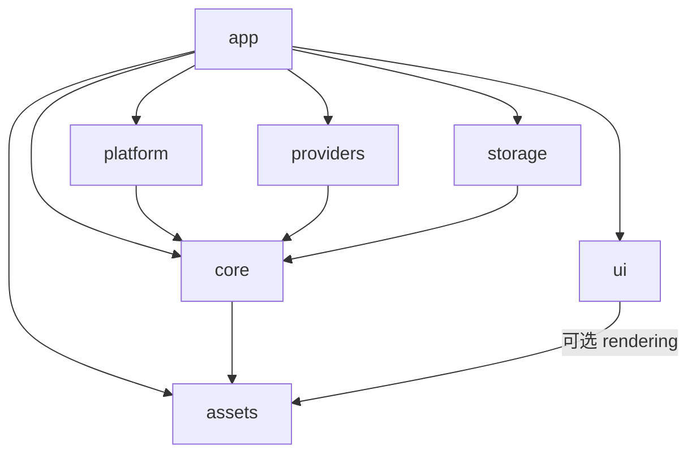

# SnapLingo 原生 Rust 架构与目录设计

日期：2026-11-10。状态：**已实施并完成本机验证**。实现基线：`cebc309`，已将此前未提交的工作保存为一次本地提交。[ARCHITECTURE.md](../../ARCHITECTURE.md) 继续描述当前实现；本文记录设计取舍；当前实现和验证范围见[验证说明](verification.md)。

## 1. 推荐结论

采用 **按产品功能组织的模块化单体 + Cargo workspace + 原生宿主**，保留领域、用例和基础设施的职责划分。目标是一个桌面应用包 `app/`、六个库包：`core`、`ui`、`platform`、`providers`、`storage`、`assets`。包内按功能聚合，只有需要隔离外部依赖、独立编译测试或被多个消费者使用的部分成为 crate。

这项选择来自产品本身：SnapLingo 是一个有截图编辑、OCR/翻译、历史收藏、多个窗口和驻留生命周期的桌面应用。它需要共享业务与界面行为，同时保留不同系统的窗口、权限、输入法和透明表面实现。它没有独立部署的业务服务，也暂时没有建设通用 GUI 框架的需求。

本设计的范围假设是 macOS / Windows 桌面产品、未来可接入 Linux，以及原生宿主和预览之间的 UI 复用。移动端、浏览器版和跨产品 UI SDK 都没有被视为已经确定的产品目标。以后若出现这些消费者，再根据实际限制调整公开 Interface。

与基线的六个生产包相比，主要的结构变化是新增 `providers`，以及理顺 UI 内部的通用绘图与产品页面归属。支持大规模迁移不意味着必须重命名所有目录；每一步都应得到可检查的依赖约束或更清楚的所有权。

### 统一组织规则与 DDD 职责

本方案确定采用功能优先的组织方式。仓库中的代码位置遵循三条规则：

1. **包按实际隔离需求划分**：业务、UI、系统能力、供应商实现、存储和资源各有明确依赖约束；产品入口使用单一 `app/`。
2. **业务和 UI 包内按功能聚合**：使用 `capture`、`result`、`settings`、`library` 等功能目录；平台和供应商包内按具体能力组织。
3. **功能内部用具体行为命名模块**：例如 `model`、`editor`、`session`、`output`；复杂功能继续按子能力拆分，不再引入可选的 `domain/application/infra` 目录模板。文件不要求一律相同，代码归属和依赖规则保持一致。

DDD 关注领域语言、模型、规则及其一致性；`domain / application / infrastructure` 表达的是常见的逻辑职责，并不等于 DDD 本身。领域建模和依赖倒置继续通过 Interface、可见性和测试落实。

本方案保留其逻辑职责：

| 逻辑职责 | SnapLingo 中的例子 | 推荐归属 |
| --- | --- | --- |
| Domain | 截图编辑状态、几何约束、收藏容量规则 | `core/<feature>` 内的模型和规则 |
| Application | 捕获 → 编辑 → OCR → 输出的协调，持久化和通知顺序 | 同一 `core/<feature>` 内的工作流和消费契约 |
| Infrastructure | SQLite、系统截图、HTTP 协议、模型推理 | `storage`、`platform`、`providers`；产品专属接线留 app |
| Presentation / composition | UI 状态和展示；依赖组装与原生生命周期 | `ui` 与 `app` 中分别有明确所有者 |

依赖约束仍然是：工作流依赖领域模型，具体 Adapter 实现消费方声明的 Interface；领域模型不依赖工作流实现或外部技术。用例消费领域值和自己的端口，Bootstrap 选择实现。不能因为文件在同一个功能目录，就允许任意双向依赖。

例如 `capture/model.rs`、`capture/editor.rs` 管状态与规则，`capture/runtime.rs`、`capture/output.rs` 管流程，所需 trait 放在消费者旁边。一个功能的规则和流程靠近放置，但模型不能导入流程实现，Core 不能导入原生或存储 Adapter。

全局 `domain/capture`、`application/capture`、`infrastructure/capture` 的形式也能工作，优势是层次一眼可见，代价是一次功能修改需要跨多棵目录导航。SnapLingo 的主要复杂度集中在截图、翻译、窗口会话等具体能力，因此这里优先选择功能内聚。此选择不否定原有分层，也不要求为每个功能引入聚合根、领域事件或仓储。

基础设施实现分别归 `platform/providers/storage`，以隔离平台、数据库和推理依赖并独立测试。产品专属执行器、更新和日志接线归 `app/integrations`。新增实现按所提供的能力归入现有所有者，避免再出现一个平行的全局 infra 集合。

## 2. 成熟项目给出的依据

调查读取了官方仓库的固定提交源码，详细证据和链接见[开源项目对照研究](../research/2026-11-10-native-workspace-architecture.md)。这里的选样强调真实平台实现与长期维护的工程项目，不对其 AI 工具使用情况作推断。

| 项目 | 借鉴到 SnapLingo 的做法 | 不直接照搬的部分 |
| --- | --- | --- |
| Zed / GPUI | 产品入口组装功能；UI 与平台窗口、文本系统各有明确 Interface | 大量细分 crate、完整 GUI 框架和应用级注册机制 |
| WezTerm | 按终端引擎、GUI、窗口能力聚合；消费方声明所需 Interface | 产品配置与窗口库的具体耦合，以及它的根目录命名 |
| iced | 类型化消息、共享状态转换；窗口运行时与绘制各有所有者 | 为通用框架设计的泛型层次和多渲染后端包 |
| Slint | 平台后端集中选择；生产与无窗口测试通过同一个 seam 接入 | 编译器、多语言绑定及完整后端选择系统 |

这些项目支持的是明确所有权和可替换实现，并不共同采用某一种“标准开源目录”。本方案借鉴其原则，不要求把 SnapLingo 改写到 GPUI、iced 或 Slint。

## 3. 目标目录

以下是主要模块布局，省略重复的 `Cargo.toml`、`src/lib.rs` 和具体实现文件。各功能按实际内容形成文件或目录。

```text
snaplingo/
├── Cargo.toml                         # workspace、公共版本/依赖约束
├── Cargo.lock
├── README.md
├── ARCHITECTURE.md                     # 当前模块图和依赖规则
├── CONTRIBUTING.md
├── app/                              # 唯一桌面产品
│   ├── Cargo.toml                    # 保持 snaplingo 包和可执行文件身份
│   ├── src/
│   │   ├── main.rs, native_main.rs    # 入口；无业务规则
│   │   ├── lib.rs
│   │   ├── bootstrap/                # 唯一产品组装入口、依赖选择/注入
│   │   ├── shell/                    # event loop、托盘、启动/退出、入口路由
│   │   ├── features/
│   │   │   ├── capture/
│   │   │   ├── result/
│   │   │   ├── settings/
│   │   │   │   ├── presenter/        # Core → UI，动作调度与会话订阅
│   │   │   │   ├── host/             # 此功能实际共享的宿主机制
│   │   │   │   ├── macos/            # AppKit、IME、AX 等具体接线
│   │   │   │   ├── windows/          # winit/Win32、IME、UIA 等接线
│   │   │   │   └── test_support/     # 仍有价值的旧原生视图基准
│   │   │   ├── pinned/
│   │   │   └── scrolling/
│   │   └── integrations/             # 产品日志/更新、执行器、UI 线程接线
│   ├── tests/                        # 产品组装、原生交互和宿主验收
│   ├── examples/                     # 产品预览与原生诊断入口
│   ├── assets/                       # 产品专属图片、图标
│   ├── resources/                    # 打包所需模型与运行库
│   └── icons/, 平台打包配置
├── crates/
│   ├── core/src/
│   │   ├── capture/                   # 捕获会话、编辑、拼接、导出规则
│   │   ├── providers/                 # 服务配置、选择、协调及业务契约
│   │   │   ├── ocr/                   # OCR 工作流、模型和引擎契约
│   │   │   └── translation/           # 翻译工作流、模型、LLM 翻译策略
│   │   ├── library/                   # 历史、收藏、容量和索引规则
│   │   ├── settings/, hotkeys/
│   │   ├── selection/, result/, pinned/
│   │   └── permissions.rs, speech.rs, updates.rs
│   ├── ui/src/
│   │   ├── foundation/                # 几何、输入、文本、外观、绘图指令
│   │   ├── capture/, result/, pinned/, scrolling.rs
│   │   ├── settings/, library/, services/
│   │   ├── notices/, permission_prompt.rs
│   │   ├── render/                    # 可选：CPU 绘制、文字测量
│   │   └── accessibility/             # 可选：共享可访问性语义投影
│   ├── platform/src/
│   │   ├── screenshot/
│   │   │   ├── mod.rs                 # 能力入口和平台选择
│   │   │   ├── macos.rs
│   │   │   ├── windows.rs
│   │   │   └── linux.rs
│   │   ├── selection/                 # 能力内部再分 OS
│   │   ├── ocr/, tts/, hotkeys/
│   │   └── clipboard_text.rs, paths.rs, required_permissions.rs, ...
│   ├── providers/src/                 # 新包：具体外部协议与推理实现
│   │   ├── http/                      # transport Interface、Reqwest adapter
│   │   ├── translation/               # Google、DeepL、Baidu 协议
│   │   ├── llm/                       # OpenAI、Anthropic、Gemini 协议
│   │   └── ocr/
│   │       ├── baidu.rs
│   │       └── paddle/                # 本地推理、ORT/MNN、设备回退
│   ├── storage/src/                   # SQLite、事务/迁移、图片文件持久化
│   └── assets/src/                    # 多个包真正共用的嵌入资源
├── assets/                            # 共享字体、默认资源、许可清单
├── reference/web/                     # React 视觉和行为基准，不是产品前端
├── tools/                             # 独立采集器、开发期工具
├── script/                            # 开发、资源准备、打包、验收
├── docs/
│   ├── architecture/, adr/, prd/
│   ├── research/, releases/
│   └── archive/
└── .github/workflows/
```

每个库遵守 Cargo 的 `src/`、`tests/`、`examples/` 习惯。小功能无需强制创建 `model/state/layout/presenter` 四个文件；内容增长到存在清楚的责任差异时再拆。`script` 与 `scripts` 都可接受，不把单复数改名作为架构迁移工作。

目前只有一个桌面产品，直接使用 `app/`，取消原 `apps/desktop/` 的中间层；macOS 和 Windows 是同一产品的不同宿主。应用内部的组装、生命周期和功能目录仍有真实职责，按内容规模组织，不强制每个功能都建立多级目录。

根目录的 Node 命令继续负责原生打包和统一开发入口。Web 独有的 Vite、Tailwind、TypeScript、HTML 入口和 public 已收拢到 `reference/web`；fixture URL、采集器、构建输出与脚本测试已同步。独立 Vitest 配置覆盖脚本和参考页，CI 单独运行 reference 构建。

## 4. 包级依赖和职责

箭头表示编译期“依赖于”，不是调用时消息的流向。



| 所有者 | 应当拥有 | 不应知道 |
| --- | --- | --- |
| Core 功能 | 模型、状态转换、操作顺序、业务错误、消费的契约 | AppKit/Win32、窗口事件循环、SQLite、Reqwest、ORT/MNN |
| UI 功能 | 展示状态、布局、命中/焦点、输入规则、用户意图、共享语义 | 数据库、供应商选择、AppState、系统窗口句柄 |
| Platform 能力 | 实际系统截图、选词、剪贴板、系统 OCR/TTS、权限等 | 产品导航、全局应用状态、持久化实现 |
| Providers | 供应商请求/响应、鉴权协议、本地推理装载和设备实现 | 窗口生命周期、产品 presenter、数据库实现 |
| Storage | 事务、schema 迁移、SQL、图片文件与一致性维护 | 哪个 Provider 应被启用、某个页面是否打开 |
| Desktop feature | 功能会话、Core 到 UI 的投影、动作调度、宿主生命周期 | 其他功能的内部字段、整套应用依赖的查找逻辑 |
| Bootstrap / shell | Bootstrap 选择和注入实现；shell 管进程并分发入口意图 | 它们不成为业务规则或布局计算的归属 |

`core` 的含义是可移植产品能力，不要求完全无副作用，也不要求只能依赖 `std`。异步协调和导出图片的标注合成属于业务；屏幕上的按钮布局属于 UI。两者都可能处理图像或矩形，不能仅按技术类型决定归属。

`ui` 不依赖 Core，使纯视图预览可以只提供展示数据。转换集中在相应 desktop presenter，避免各 OS 各自映射。少量形状相似的数据类型是有意隔离；不通过一个全局 `types/common` crate 把所有功能再次绑在一起。

## 5. UI 复用的 Interface

产品功能按以下方向协作；这是职责示意，不要求每个页面强制实现同一个泛型 trait：

```text
Core 工作流的状态
    ↓ desktop presenter 投影
UI Snapshot + 本地交互状态
    + 归一化输入 → 类型化 Intent
    + 布局/文字测量 → 绘图输出、命中信息和语义
    ↓ native host 呈现
AppKit 控件或 CPU 绘制表面

Intent → presenter 调用 Core / 明确的系统效果 → 新 Snapshot
```

共享内容包括选中状态、布局、输入转换、键盘导航、可访问性语义；原生宿主负责窗口、设备 DPI、坐标转换、IME、AX/UIA、焦点、系统菜单/对话框和像素呈现。AppKit 使用原生控件、Windows 使用共享 scene 仍然可以共享同一份 presentation，不必把两种窗口实现强行合成一个庞大的 Host trait。

本次迁移对两个既有结构作了明确调整：

1. 原 Settings Scene 混合绘图和页面数据。现在 [foundation::Scene](../../crates/ui/src/foundation/scene.rs) 只包含尺寸和绘图指令，[SettingsFrame](../../crates/ui/src/settings/scene.rs) 与各功能 frame 分别拥有命中、滚动、IME 和语义；[Renderer](../../crates/ui/src/render/mod.rs) 只接受纯绘图数据。
2. [ResultSnapshot](../../crates/ui/src/result.rs) 等独立窗口改为接收小的 `Appearance`，键位风格由实际需要的视图显式传入。完整的 Settings 配置、导航、OCR/截图/翻译字段继续属于 Settings。

UI 包内部也需要依赖方向：`foundation` 不依赖任何产品页面；`render` 只依赖绘图/文字基础；产品视图依赖 foundation；可访问性投影可以消费对应视图的语义。日后有真实的第二个产品消费者时，才考虑把通用基础/控件提取为独立 UI 包。

## 6. 为什么新增 providers，而不继续拆更多包

迁移前，云端协议分散在 Core 的翻译/OCR 实现和桌面的 LLM 集成中，本地推理也直接归桌面应用。现在统一归入 [providers](../../crates/providers/src)：[翻译协议](../../crates/providers/src/translation)、[LLM](../../crates/providers/src/llm) 和 [OCR](../../crates/providers/src/ocr)。ORT/MNN/ndarray 已由可选推理模块拥有；应用更新下载仍实际使用 Reqwest。

`providers` 独立成包的理由现在就存在：它能独立验证协议和推理，控制推理重依赖，并使 Core 工作流与 UI 预览无需构建模型运行库。不是等待一个假设中的 CLI 才有价值。不过，应用完整构建仍需要所选推理依赖，搬包本身不会消除它们或保证整体编译更快。

迁移按“外部实现”和“产品策略”区分，不是把名字带 Provider 的内容全部搬走：

| 内容 | 目标归属及原因 |
| --- | --- |
| OCR/翻译协调、服务选择、凭据持久化顺序、配置/通知规则 | Core；这些是产品行为 |
| `LLMTranslationProvider` 的 prompt、温度、翻译工作流 | Core；只通过 `LLMClient/LlmRuntime` 消费能力，配置工作流可继续直接创建它 |
| Paddle/System/Tesseract 的纯策略 wrapper 与引擎契约 | Core；没有原生依赖，不因其名字包含具体引擎就整体外移 |
| Google/DeepL/Baidu、OpenAI/Anthropic/Gemini 的 wire protocol | Providers；变化由外部服务决定 |
| ORT/MNN 模型 session、设备选择及推理回退机制 | Providers；软件引擎实现，启动时接收模型和 cache 路径 |
| Vision/WinRT、Tesseract 的实际系统/原生库接入 | Platform；按已有可用平台和依赖限制选择 |
| `HttpClient` 契约和 Reqwest 实现 | 最后一个 Core 协议消费者迁走后一起归 Providers；契约跟随其消费方 |

HTTP 迁移保留现有动态配置语义：代理、超时和重试设置在后续请求中生效，客户端按配置缓存。首轮可继续注入 Core 的 `SettingsConfiguration`，不顺手改成启动时读取一次静态配置；已有“更改设置后无需重启”的测试随实现迁移。

采用可选 `local-ocr` 等少量 feature 隔离推理依赖，默认协议测试不拉入模型引擎；真实产品在 desktop manifest 显式启用所需能力。OS 专属 CoreML/DirectML/MNN 依赖仍由目标条件和 feature 共同控制。模型下载、打包和默认路径选择归产品工具/组装，库接收路径而不寻找已安装应用。

Core 中 [Tesseract 契约](../../crates/core/src/providers/ocr/mod.rs) 的 OS 条件已移到实现选择处：纯 Rust 契约和假实现测试在所有平台可见，实际 native adapter 才有可用性限制。这不会自动增加 Windows Tesseract 产品支持。

保留一个 platform 包，内部按“能力 → OS”组织；保留一个 UI 包及可选 render/accessibility 模块；Core 的业务功能先保持普通模块。新增 crate 的门槛是明确的独立依赖、测试、消费者或发布需求。当前没有充分理由拆出全局 `domain`、`application`、`ports`、`runtime`、`common` 包。

## 7. 模块规则和运行时责任

- **功能内聚**：模型、规则、消费的 trait 和测试靠近功能。跨功能通过明确公开 Interface 交互；默认私有或 `pub(crate)`，不通过大量根级通配导出掩盖所有权。
- **一次组装**：只有 Bootstrap 从整套 AppState 解析功能依赖并选择真实实现；shell 持有已经组装的运行入口。Feature 接收自己的依赖集合或工厂；Platform/Providers/Storage 不向应用查找依赖。
- **直接命令、有限通知**：需要结果的操作直接调用功能 Interface；已完成的状态变化可以发布类型化通知。订阅者持有取消/释放责任，不用全局事件总线替代所有函数调用。
- **一处业务状态**：OCR 请求有效性、过期结果拒绝、截图导出顺序归对应 Core 工作流。Presenter 维护投影及视图生命周期，不再维护一套相同业务规则。
- **UI 线程有明确所有者**：窗口及原生对象留在 UI 线程；网络、推理、数据库或重图像任务通过现有执行机制处理。窗口关闭释放订阅并失效化回调，退出取消或排空后台任务。
- **能力实现集中选择**：`cfg(target_os)` 出现在 native adapter、平台入口及 bootstrap。真正不同的能力可以返回不可用状态，不让纯配置或业务契约随当前 OS 消失。
- **坐标和资源属于接口约定**：逻辑 DIP、设备比例、用户缩放分别处理；截图像素与屏幕几何一起冻结。字体资源按共享用途归属，产品图标/模型包不向所有基础库扩散。

Linux 扩展需要实现缺失的系统能力与完整 desktop host，并验证 Wayland/X11 的截图、快捷键和权限机制。目录预留 Linux 位置并不等于 Linux 产品已经可用。当前产品仍以 macOS / Windows 为实际验收目标。

## 8. 持续验证

架构测试检查实际依赖方向，包含目标平台、可选功能和构建依赖。UI 内部的 foundation/render 方向也纳入检查；源码扫描是补充，不能代替行为和原生验收。

沿用 Core 流程/并发/过期结果测试、供应商协议 fixtures、Storage 真实事务、UI 布局/输入/renderer 基准和原生宿主验收。保留的 [AppKit 参考实现](../../app/src/features/settings/test_support) 仅用于测试，不能替代生产共享页面验收。

完整命令和平台覆盖范围见[验证说明](verification.md)。普通产品与启用 test-support 的验收构建分别检查；Windows 交叉编译和真实 Windows 桌面验收分别记录。已完成的临时迁移清单由 Git 历史保存。
