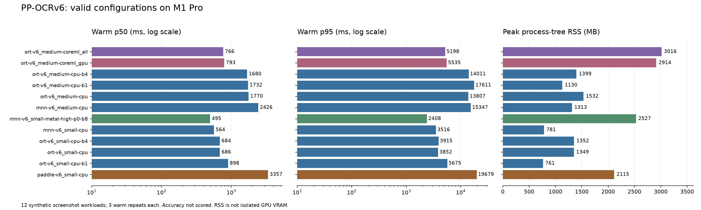
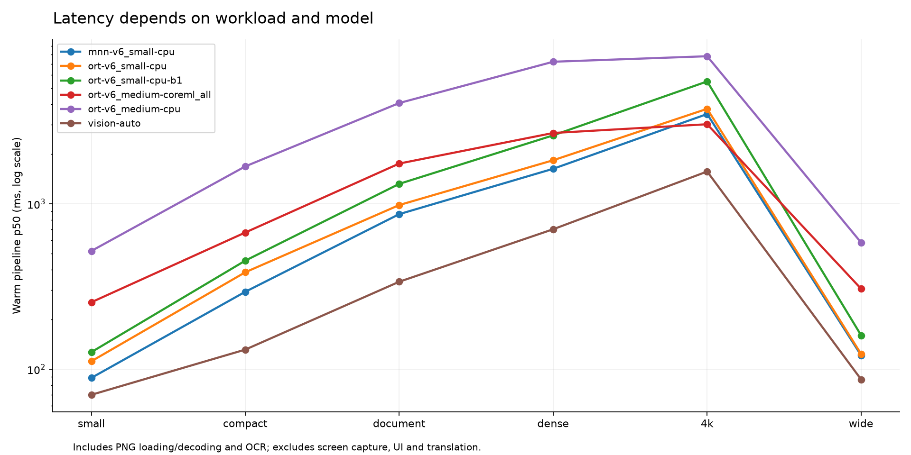

# SnapLingo 中英文端侧 OCR 实测对比

> 日期：2026-11-01。本报告的基准阶段不比较识别精度；没有 Windows 测试机。实际运行环境为 Apple M1 Pro、8 核 CPU / 14 核 GPU、16 GB 内存、macOS 14.8.3。Windows 和 Intel Mac 只核查平台、构建及分发支持，不给性能排名。基准阶段未修改产品实现；后续按用户确认的 medium 方案新增了 PaddleOCR provider，见 [ADR 0011](../adr/0011-local-paddle-ocr.md)。

## 产品选型确认

用户确认采用 **PP-OCRv6 medium 检测＋识别模型**：截图翻译主要处理小选区，接受其 CPU 成本。后续以 ONNX Runtime 为主引擎，提供“启用 GPU 加速”开关，按平台选择后端；关闭 GPU 或后端初始化失败时使用 CPU，模型档位保持 medium。

| 平台 | CPU 路线 | GPU 路线与验收状态 |
| --- | --- | --- |
| Windows x64 | ORT CPU | 首选 ORT DirectML；覆盖多厂商 GPU 的部署路线已核查，运行与性能仍待真机验收 |
| Apple Silicon、macOS 14+ | ORT CPU | ORT Core ML，`CPUAndGPU` 配置已实测；允许部分算子在 CPU 执行 |
| macOS 12/13、尚未验证 GPU 的 Intel Mac | MNN medium CPU 作为兼容路线 | 先采用 CPU；旧系统与 Intel 架构仍需真机验收，当前 ORT 成品库不能直接覆盖 macOS 12/13 |

本机 512×100 小选区的预热后中位耗时：ORT medium CPU 约 **518 ms**，Core ML `CPUAndGPU` 约 **252 ms**。这两项仅包含基准定义的 OCR 流程，不包括截图 UI 和翻译。实际接入需长期复用模型/session，并将首次模型准备成本单独处理。识别精度仍按用户要求暂不比较。

选型已通过独立的 `paddle-ocr` provider 接入现有协调器，GPU 开关位于 OCR 设置，具体后端选择收在 Infrastructure。现有 provider 选择仍按持久化恢复。下面保留原始基准结论；产品接入的配置、分发及验证入口见 [ADR 0011](../adr/0011-local-paddle-ocr.md)。

## 基准结论与取舍

**单看 CPU 性能、资源和现有项目接入成本，MNN＋PP-OCRv6 small 表现突出。** 本机完整测试中，PNG 读取/解码、前后处理与 OCR 的中位耗时为 **564 ms**，峰值进程 RSS 约 **781 MB**。固定版本 Rust OCR 库已实际构建，Mac 原生验证程序最低系统版本为 11.0，符合项目当前 macOS 12 的成品加载条件；低版本 Mac 的实际运行仍需验收。Windows x64 有对应原生库路线，但本轮没有执行 Windows 测试，不能保证同样的性能优势。

**较大模型的 Mac GPU 配置选 ONNX Runtime＋PP-OCRv6 medium＋Core ML。** 在同一个 medium 模型与同一套前后处理下，Core ML 自动选择计算设备时中位耗时为 **766 ms**，CPU 为 **1,770 ms**，约快 **2.3 倍**；峰值进程 RSS 从约 **1.53 GB** 增至 **3.02 GB**。这支持为较大模型采用平台 GPU 策略，但不能证明 medium 的识别质量在本项目更好，也不能说它在所有输入上都快于 small CPU。

**不建议直接采用当前 MNN 的 PP-OCRv6 Normal Metal 配置。** tiny、small、medium 都出现带文字图片返回空结果的情况；这些配置的低耗时不能作为有效速度优势。small 的 High / batch 8 配置通过基础检查，热运行比 CPU 略快，但首次遍历 12 种输入耗时约 185 秒，单图首次运行最高约 43 秒，峰值 RSS 约 2.53 GB；batch 32 又出现 Tensor 异常。当前更适合作为需解决首次输入成本的 GPU 候选。

**Paddle Inference C++ 不是本项目必须采用的引擎。** 本机官方 Mac CPU SDK 下，tiny、small 完整测试分别约为 ONNX CPU 耗时的 **5.4 倍 / 4.9 倍**；更大模型未完成本轮整组时间预算。能运行 v6 的已验证 SDK 还要求 macOS 13.6，动态运行库约 258 MB。此结论只适用于所测 Mac CPU SDK，不外推到 Windows NVIDIA CUDA。

建议保留以下平台策略：

| 平台 / 目标 | 推荐起点 | 依据与限制 |
| --- | --- | --- |
| Windows x64、macOS 12+ 的 CPU 基础方案 | MNN＋v6 small，CPU、4 个推理线程、默认并行文字行策略 | Mac 已实测；Windows 有构建/成品支持，需真机验收。固定模型转换版本及原生库，不以 FP16 存储推断精度等价 |
| Apple Silicon、macOS 14+、希望运行 medium | ONNX Runtime 1.31.1＋Core ML；比较 `ALL` 与 `CPUAndGPU` | medium 有明确本机性能收益；约 3 GB 峰值进程 RSS、首次模型准备较慢；最新官方运行库实际要求 macOS 14 |
| Windows GPU | 后续首先比较 ORT DirectML 与 MNN Vulkan，NVIDIA 再加 CUDA | DirectML 覆盖 AMD/NVIDIA/Intel；本轮无实测，暂不确定默认 GPU 引擎或模型档位 |
| 极低包体 / 延迟需求 | v6 tiny CPU 作为候选 | MNN 中位耗时 156 ms、模型与字典约 3.18 MB；识别精度尚未比较，不能据性能将 tiny 定为质量首选 |

## 测试方法与数据边界

本轮运行了 **41 组完整矩阵配置的尝试**：24 组基础引擎/模型组合、7 组 Metal 策略、10 组 CPU batch / Paddle / Tesseract 对照；另有兼容性、后端审计和预检查。汇总包含 **50 条配置记录、1,719 次图片观察**，其中 26 条通过完整 36 个热运行样本及基础非空检查。超时、内存限制和空输出保留为失败证据。

- 输入为 12 张确定性生成的中英文截图形态 PNG：6 种尺寸各有浅色、深色版本，包含中英混排、代码、URL 等。它们是性能工作负载，不是真实失败样本，也不是精度金标准。
- 完整组每图预热 1 次，再运行 3 次，共 36 个热运行样本。p50 / p95 是这组样本的经验分位数，不能当作生产环境 SLA 或统计置信区间。
- 表中整条流程包括 PNG 读取/解码、检测、文字行裁剪、识别和结果处理；不包括屏幕采集、选区 UI、翻译或网络请求。
- ORT / Paddle 使用相同 RapidOCR 前后处理、相同检测边长 960、识别 batch 8 等参数。Paddle 实际通过 C++ `Predictor::Run` 推理，Python 只组织共同流程。MNN 使用原生 Rust OCR 流程，前后处理和字典/权重格式存在差别，因此跨 MNN 的数据是整体方案比较，不是完全相同计算图的引擎微基准。
- CPU 推理线程设为 4；库的图像处理、并行文字行处理可能使用其他工作线程。CPU 占用记录实际采样值，不将线程配置当成总 CPU 上限。
- CPU/GPU 测试串行运行，准备步骤在必要时于组间暂停。模型、驱动和操作系统缓存未彻底清除；模型加载及首次输入数据是新进程下的组件准备成本，不是冷机启动数据。
- 每个进程组时间上限 300 秒，进程树采样 RSS 上限 6,000 MB，采样间隔 50 ms。触发限制表示本轮配置无法完成预算，不表示该引擎在任意机器上都无法运行。
- **RSS 不等于独立 GPU 显存。** M1 为统一内存，Core ML 系统服务和部分 GPU/驱动分配可能在被测进程之外。Python 参考流程的 RSS 也不能直接当作最终 Rust 应用的 RSS。

原始观察的浓缩数据、逐类指标及配置参数见 [数据目录](./2026-11-01-ocr-benchmark/)，其中有 [summary.csv](./2026-11-01-ocr-benchmark/summary.csv)、[summary.json](./2026-11-01-ocr-benchmark/summary.json)、[case-metrics.csv](./2026-11-01-ocr-benchmark/case-metrics.csv) 与 [observations.jsonl](./2026-11-01-ocr-benchmark/observations.jsonl)。原始完整日志与模型在 `/tmp/snaplingo-ocr-benchmark/`。

## 主要完整结果

单位均为十进制：`1 MB = 1,000,000 bytes`。以下配置通过了全部 36 个热运行样本及非空检查；这不是精度通过。

| 整体方案 | 热运行 p50 | 热运行 p95 | 峰值进程树 RSS | 说明 |
| --- | ---: | ---: | ---: | --- |
| MNN v6 tiny CPU | 156 ms | 859 ms | 463 MB | 性能/包体轻量候选 |
| MNN v6 small CPU | **564 ms** | **3,516 ms** | **781 MB** | 本轮 CPU 综合起点 |
| MNN v6 small High Metal，parallel false / batch 8 | 495 ms | 2,408 ms | 2,527 MB | 热运行有效；首次输入成本很高，见后文 |
| ORT v6 small CPU，batch 8 | 686 ms | 3,852 ms | 1,349 MB | 官方 ONNX、共同参考流程 |
| ORT v6 small CPU，batch 4 | 684 ms | 3,915 ms | 1,352 MB | 本机未看到显著改善 |
| ORT v6 small CPU，batch 1 | 898 ms | 5,675 ms | 761 MB | 内存降低约 44%，延迟增加 |
| ORT v6 medium CPU，batch 8 | 1,770 ms | 13,807 ms | 1,532 MB | 较大模型 CPU 成本 |
| MNN v6 medium CPU | 2,426 ms | 15,347 ms | 1,313 MB | medium 的原生 CPU 兼容候选 |
| ORT v6 medium Core ML `CPUAndGPU` | 793 ms | 5,535 ms | 2,914 MB | 设备允许 CPU/GPU，不保证全图 GPU |
| ORT v6 medium Core ML `ALL` | **766 ms** | **5,198 ms** | **3,016 MB** | 本轮较大模型 GPU 起点 |
| MNN v5 mobile FP16 CPU | 552 ms | 3,871 ms | 901 MB | 上一代对照 |
| MNN v5 mobile FP32 CPU | 555 ms | 3,946 ms | 940 MB | 本机 FP16 存储未带来明显速度收益 |
| ORT v5 mobile CPU | 685 ms | 4,186 ms | 1,668 MB | 与 v6 small 接近，精度未比较 |
| ORT v5 server CPU | 3,479 ms | 17,784 ms | 2,048 MB | 旧代大模型成本较高 |
| Paddle C++ v6 tiny CPU | 1,032 ms | 5,430 ms | 1,150 MB | 同一 RapidOCR 前后处理 |
| Paddle C++ v6 small CPU | 3,357 ms | 19,679 ms | 2,115 MB | 同一 RapidOCR 前后处理 |
| Apple Vision 自动选择设备 | 246 ms | 1,580 ms | 317 MB | 原生基线；未包含项目的低置信度增强重试 |
| Apple Vision CPU 请求 | 617 ms | 2,213 ms | 484 MB | 系统 API CPU 请求基线 |
| Tesseract 5.5.1 CLI | 1,773 ms | 20,389 ms | 251 MB | `chi_sim+eng`、PSM 3；每图包含 CLI/模型初始化，非逐项复刻 Rust provider |

### 不同工作负载的差别
| 热运行中位耗时 | 小选区 512×100 | 紧凑 960×320 | 文档 1280×960 | 密集 1920×1080 | 4K 3840×2160 | 长条 2400×180 |
| --- | ---: | ---: | ---: | ---: | ---: | ---: |
| MNN v6 small CPU | 89 ms | 294 ms | 866 ms | 1,628 ms | 3,489 ms | 121 ms |
| ORT v6 small CPU | 112 ms | 386 ms | 983 ms | 1,834 ms | 3,752 ms | 124 ms |
| ORT v6 medium Core ML ALL | 254 ms | 670 ms | 1,751 ms | 2,680 ms | 3,027 ms | 306 ms |
| ORT v6 medium CPU | 518 ms | 1,683 ms | 4,067 ms | 7,227 ms | 7,802 ms | 583 ms |
medium GPU 在 4K 工作负载上甚至略快于 small CPU，但在小选区和文档上仍然更慢。这支持按模型档位和平台选择推理策略，不支持仅以“启用 GPU”决定默认配置。

## GPU 与基础正确性发现

### MNN Metal

已实际确认 Metal 原生注册，并为基准添加了会话主后端检查，防止整组静默降为 CPU；个别算子的 CPU backup 仍可能存在。

| 配置 | 本轮结果 |
| --- | --- |
| v6 tiny / small / medium，Normal Metal，默认并行 | 分别有 **12 / 12 / 18 个热运行样本空输出**；CPU 同图为非空。低耗时数据排除出有效推荐 |
| tiny，High Metal、默认并行 | 36 样本非空，中位整条流程约 198 ms；CPU tiny 约 156 ms |
| small，Normal Metal、真正 batch 8 | 仍有 12 个热运行样本空输出，说明仅切 batch 不足以修复基础问题 |
| small，High Metal、真正 batch 8 | 36 个热样本非空；热运行 p50 495 ms / p95 2,408 ms；首次遍历输入累计约 185 秒、单张首次文档约 43 秒，峰值 RSS 约 2.53 GB |
| medium，Normal Metal、真正 batch 8 | 仍有 18 个热运行样本空输出 |
| small / medium，High Metal、batch 32 | 超时；观察到 `tensor fetch_name_0 shape is too large` 等异常，无完整有效排名 |
| medium，High Metal、batch 8 | 达到整组时间上限，无完整有效排名 |

源码核查发现，`parallel=true` 且文字框数量较多时采用 `ExactWidthParallel`，逐框输入 N=1，batch 配置没有实际生效。补测设置了 `parallel=false`，确实进入 `boxes.chunks(batch_size)` 的批量路径；另加输出 N 完整性诊断，避免模型返回不足 N 后静默丢结果。原生代码及补丁见 [MNN harness](../../script/ocr-benchmark/mnn/README.md)。

High 模式恢复非空属于基础可用性证据，**不等于已经证明字词识别正确、与 CPU 精度一致或全部算子由 GPU 执行**。当前固定版本和转换模型组合需要进一步定位 GPU 数值/动态尺寸问题，正式方案先用 CPU。

这里应区分热运行和首次输入：High / batch 8 的 36 个热样本总耗时约 32.8 秒，而第一遍 12 张输入总耗时约 185 秒。仅看预热后的 p50/p95 会掩盖交互式截图遇到新输入时的成本。本轮没有定位它具体来自哪些编译、调度或形状处理环节，也没有证明任意新截图都会重现相同等待时间。

### ONNX Runtime Core ML

- v6 small 的 MLProgram 格式 `CPUAndGPU` / `ALL` 都达到整组时间上限；观察到单张 4K 输入超过 22 秒。
- v5 mobile 的 MLProgram GPU 配置触发 6 GB 进程 RSS 上限；v5 server 在建会话时出现 MaxPool `ceil_mode` / `same` 的 Core ML 编译错误。
- 补测 NeuralNetwork 格式：v6 small 两张探测图非空，但文档仍约 4.1 秒；v5 server 变为可建会话，却出现小图空输出、文档明显不足的基础异常，没有列为有效方案。
- v6 medium 完整矩阵通过；另做了 ORT profiling。检测/识别会话都有 `CoreMLExecutionProvider` 节点执行，也都有 CPU 节点，见 [后端审计](./2026-11-01-ocr-benchmark/provider-audit.json)。这确认 Core ML 实际参与，不是只登记了 provider；该计数不是 GPU 利用率或耗时占比，也无法单独证明 `ALL` 使用了 Neural Engine。

## Paddle Inference C++ 的实测结论

3.0.0 官方 Mac arm64 SDK 可以编译桥接，但不能加载本次 v6 模型：`CreatePredictor` 的 PIR 卷积属性类型不兼容。另一官方下载路径 3.3.1 的包可以运行 v6，包内实际版本为 **3.3.0.dev20260319**，并非按 URL 推断的正式 3.3.1 内部版本。

共同前后处理下，tiny / small 完整测量中，C++ `Predictor::Run` 占整条流程耗时比例的中位值分别约 **94.6% / 97.3%**。因此本次慢主要发生在原生引擎调用阶段，不能简单归因于 Python 调度或结果复制。这里也没有测量完全 C++ 实现的 OCR 前后处理。

medium、v5 mobile、v5 server 都达到 300 秒整组预算，没有完整 36 样本结果。无需因此否定 Paddle 的 Windows CUDA 路线；对当前至少覆盖 Mac、Windows 的 SnapLingo，本轮没有显示出采用这个 Mac CPU SDK 的优势。桥接、错误和来源见 [Paddle harness](../../script/ocr-benchmark/paddle/README.md)。

## 包体、最低系统版本与跨平台成本

下表是实际文件/构建信息，**不是最终 Tauri 安装包或 Rust 应用的实测增量**。dSYM、SDK 头文件和整套 Python 环境不应误算进产品运行库。

| 组件 | 实际文件规模 / 最低系统版本 | 集成影响 |
| --- | --- | --- |
| 本轮 MNN Rust 独立程序 | 约 8.5 MB，含静态 MNN 与 OCR 流程；Mach-O minos 11.0 | 只依赖 Apple 系统框架；满足项目 macOS 12 条件。CPU 专用产品构建需单独测安装包增量 |
| MNN v6 tiny / small / medium 模型＋字典 | 3.18 / 15.69 / 69.54 MB | 主卷积权重已检查为 FP16 存储、bias FP32；转换模型源与字典均固定 hash |
| 官方 ONNX v6 tiny / small / medium 两权重 | 6.24 / 31.04 / 138.59 MB | 官方模型来源，另需字典和运行库；不是峰值 RAM |
| ORT 1.31.1 官方 Mac arm64 C++ dylib | 44.80 MB；**minos 14.0** | 本轮 Python 包的运行库也要求 14.0；不能直接覆盖 macOS 12 |
| ORT 1.23.2 官方 Mac universal2 dylib | 74.90 MB，双架构；**minos 13.4** | Intel/Apple Silicon 成品存在，仍不能直接覆盖 macOS 12；五组模型在本机 CPU 探测通过 |
| ORT 1.20.1 官方 Mac universal2 dylib | 54.11 MB；**minos 13.3** | 进一步说明“Core ML API 支持 macOS 12”不等于当前成品运行库支持 12；本轮仅检查该包构建信息 |
| Paddle 可跑 v6 的官方 Mac SDK 动态库 | 四库合计 **257.89 MB**；**minos 13.6** | 要随应用部署/签名，不能原样满足项目 macOS 12；需另构建或选择其他引擎 |

最低版本来自实际 Mach-O `LC_BUILD_VERSION`，没有仅依据文档 API 条件或 CMake 变量推断。详见 [环境与原生库信息](./2026-11-01-ocr-benchmark/environment.json)、[Paddle SDK 信息](./2026-11-01-ocr-benchmark/paddle-sdk-models.json)。如果选择 ORT 在 macOS 12 上运行，需要另行固定可用库或自行构建并验收；本轮没有完成这个产品构建。

Windows 支持的关键条件见 [平台核查](../../script/ocr-benchmark/windows-support.md)：

- ORT CPU、DirectML、CUDA 有 Windows x64 路线。DirectML 覆盖多厂商 DX12 GPU，要求关闭 memory pattern、`ORT_SEQUENTIAL`，同 session 不可并发 `Run`；这与 CPU memory arena 是不同选项。本次 v6 原始 ONNX 的 opset 为 14/11，处于所核查 DML 文档的 opset 范围内，但仍需逐节点/真机验证。
- 固定 MNN 3.6.1 的社区成品有 Windows CPU、Vulkan/OpenCL、CUDA profile；当前 Rust 原生库成品选择要求静态 CRT，条件不满足可能转为源码构建。不能将“库存在”当作 SnapLingo 的 Windows 安装器已经验收。
- CUDA 只覆盖 NVIDIA，还需匹配其运行库/驱动；MNN 本次固定 profile 与 ORT 的 CUDA 条件不同。
- 统一 Windows/Mac CPU 接口、按平台选 GPU 是可行方向；Windows 最终默认须由集显/独显真机数据决定。

## 接入 SnapLingo 的复杂度

| 路线 | 本轮已完成 | 产品集成工作 |
| --- | --- | --- |
| MNN / `ocr-rs` | Rust release 构建、CPU / Metal 运行、模型 FP16/FP32 检查、原生库来源/后端诊断 | 固定社区代码、转换模型和字典；Windows CRT/构建；映射坐标与置信度；GPU 当前异常配置排除 |
| Rust / ORT | Python 参考流程＋官方原生库实测；模型与后端验证 | 选可用 API/运行库版本；复用或移植检测/裁剪/CTC；Mac 最低版本；Windows DML 等后端参数与 DLL 分发。已有 `oar-ocr` 也需核验其工具链/特性成本 |
| Paddle C++ | 最小 C++ predictor＋ctypes 共同流程桥接、v6 兼容验证 | C/C++ FFI、前后处理、四个较大动态库/RPATH/签名、SDK/PIR 兼容与最低系统版本；当前 Mac 成本最高 |

后端可实现现有 `OcrProvider`，复用 `OcrCoordinator` 的激活、持久化和事件机制。截图与文件 OCR 已共享协调器，不需要分别复制流程。模型/session 应长期复用，推理在工作线程执行。输出矩形需转换为项目当前归一化、左下原点的 `OcrResult.lines` 坐标，不能直接返回库的左上像素坐标。

基准使用 Rust 1.92，当时项目 Cargo 声明为 1.77.2。后续产品接入采用原生 Rust 流程，依赖的 ORT Rust 版本要求 1.88，项目声明已相应调整；Python 基准程序仅用于本报告的测量。

## 可复现材料与下一步

入口见 [基准脚本 README](../../script/ocr-benchmark/README.md)。记录了模型 SHA-256、原生库/SDK 版本、构建来源、前后处理参数、逐图热运行、资源采样和失败配置。

产品选型已按用户的小选区场景确定为 medium，详见开头的“产品选型确认”。Windows 和 Intel Mac 的运行、安装与 GPU 验收尚未完成；用户真实中英文失败样本的精度/格式保留对照按用户要求暂不进行。基准结果仍表明 MNN v6 small 的 CPU 性能/资源优势，以及 ORT v6 medium Core ML 相对同模型 CPU 的本机加速收益；Paddle Mac CPU 本轮无优势。

## 一手来源

1. [PaddleOCR v3.7.0 / PP-OCRv6](https://github.com/PaddlePaddle/PaddleOCR/releases/tag/v3.7.0)、[官方算法与模型说明](https://github.com/PaddlePaddle/PaddleOCR/blob/main/docs/version3.x/algorithm/PP-OCRv6/PP-OCRv6.md)。本报告没有用官方精度分数替代本项目精度实测。
2. [RapidOCR v3.10.0](https://github.com/RapidAI/RapidOCR/tree/v3.10.0)、[配置](https://github.com/RapidAI/RapidOCR/blob/v3.10.0/python/rapidocr/config.yaml)。
3. [官方 ONNX 模型列表与固定 revision/hash](./2026-11-01-ocr-benchmark/onnx-models.json)。
4. [`ocr-rs` 固定 revision](https://github.com/zibo-chen/ocr-rs/tree/664a945953e46186b37203fa4902a20d60a32809)、[MNN 原生库成品发布](https://github.com/zibo-chen/mnn-native-prebuilds/releases/tag/mnn-3.6.1-d407447e-r1)、[MNN 模型/hash](./2026-11-01-ocr-benchmark/mnn-models.json)。成品包是该 Rust 集成作者发布，不能称为 Alibaba 官方成品 SDK。
5. [ORT Core ML EP](https://onnxruntime.ai/docs/execution-providers/CoreML-ExecutionProvider.html)、[DirectML EP](https://onnxruntime.ai/docs/execution-providers/DirectML-ExecutionProvider.html)、[CUDA EP](https://onnxruntime.ai/docs/execution-providers/CUDA-ExecutionProvider.html)。
6. [ORT 1.31.1](https://github.com/microsoft/onnxruntime/releases/tag/v1.31.1)、[1.23.2](https://github.com/microsoft/onnxruntime/releases/tag/v1.23.2)、[1.20.1](https://github.com/microsoft/onnxruntime/releases/tag/v1.20.1) 成品包；最低系统版本另以实际文件检查为依据。
7. [Paddle 官方 Mac SDK 下载页](https://www.paddlepaddle.org.cn/inference/v3.0/guides/install/download_lib.html#mac)、[Mac CPU 编译说明](https://www.paddlepaddle.org.cn/inference/v3.0/guides/install/compile/source_compile_under_MacOS.html)、[实测 SDK / 模型清单](./2026-11-01-ocr-benchmark/paddle-sdk-models.json)。
8. [Tesseract 数据与模式说明](https://tesseract-ocr.github.io/tessdoc/)。本机版本与参数以实际 CLI 输出及脚本为依据。
